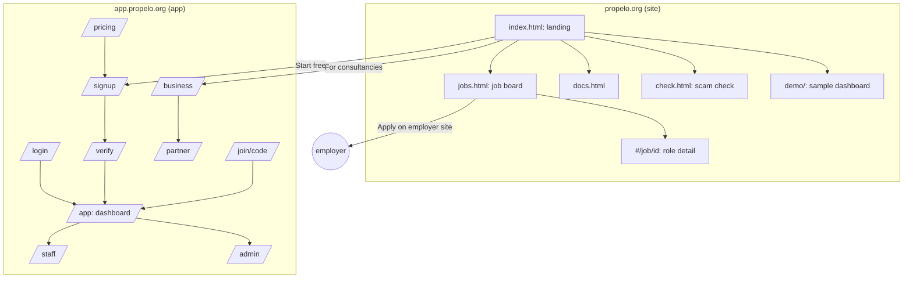

# 02 · Master sitemap

Two hosts: the **site** `propelo.org` (GitHub Pages, static, built by the scan) and the **app** `app.propelo.org`
(Render, FastAPI). Status: **Verified** = executed and seen working in this audit (see `qa-tests.csv`);
**Implemented** = exists, not separately exercised; **Partial**; **Missing**; **Not verified**.
Every page route the app serves must appear below in backticks (checked by `tests/test_product_docs.py`).

## 1. Public website (propelo.org)

| page | route | user | purpose | auth | main actions | connects to | status |
| --- | --- | --- | --- | --- | --- | --- | --- |
| Landing | index.html | visitor | Explain, prove with live roles, convert | none | Start free, For consultancies, Browse jobs, Pricing section, Guarantees section | app signup, jobs, docs, business | Verified |
| Job board | jobs.html (+ `#/job/<id>`, `#/companies`, `#/api`) | visitor, job seeker | Browse and filter 58k+ roles; role detail with quotes | none | Search, filter, open role, apply on employer site | employer pages, app signup | Verified |
| Docs | docs.html | developer, power user | Install, own key, run locally | none | Read | GitHub | Verified |
| Scam check | check.html | anyone with a suspicious offer | Free warning-sign check, in the browser | none | Paste text, see signals | app signup | Verified |
| Sponsor check | sponsor-check.html | anyone abroad | Free lookup: is this employer on the UK or Dutch sponsor register? Runs in the browser | none | Search a company, open its roles | job board, app signup | Verified (local build) |
| Visa sponsor jobs | visa-jobs.html, visa-jobs-uk.html and six more countries; lists/*.md | students and graduates abroad, search engines | Recent junior and mid-level roles with a sponsorship signal, rebuilt by every scan | none | Open a role, sign up, check an employer | job board, app signup | Verified (local build) |
| Demo | demo/index.html | visitor | Dashboard with fictional data | none | Click around | app signup | Verified (noindex) |
| 404 | 404.html | anyone | Lost link recovery | none | Home, jobs, docs | | Implemented (generated) |
| robots / sitemap / RSS / API | robots.txt, sitemap.xml, feed.xml, api/jobs.json | crawlers, developers | Discovery and reuse | none | | | Implemented |
| About / team | (none) | visitor, partner | Who is behind it, why trust it | none | | | **Missing** |
| Blog / guides | (none) | visitor from search | Organic acquisition | none | | | **Missing** |
| Help centre / FAQ | partial: FAQ blocks on pricing, docs page | member | Self-serve answers | none | | | **Partial** |
| Changelog | CHANGELOG.md in GitHub only | member, partner | What changed | none | | | **Partial** |
| Status page | (none) | member, partner | Is it down? | none | | | **Missing** |
| Case studies / testimonials | (none) | buyer | Proof | none | | | **Missing** (no customers yet; must not be invented) |

## 2. Authentication and account (app)

| page | route | purpose | auth | states | status |
| --- | --- | --- | --- | --- | --- |
| Sign in | `/login` | Email + password, or LinkedIn | none | error, unverified, throttled, two-step code step | Verified |
| Two-step code | `/login` (mfa step, also `#mfa=` after LinkedIn) | Code from authenticator or recovery code | ticket (5 min) | wrong code, expired, throttled | Verified |
| Create account | `/signup` | Name, email, password, terms | none | closed/allowlist, sent | Verified |
| Check inbox | `/signup` (sent state) | Resend link | none | | Verified |
| Confirm email | `/verify` (`#token=…&next=…`) | One-time link, returns to join/business page | token | expired, used | Verified |
| Forgot password | `/forgot` | Send reset link | none | always neutral message | Implemented |
| New password | `/reset` (`#token=`) | Set new password, signs out other devices | token | expired | Implemented |
| Change password | `/app#setup` › Account | | session | | Implemented |
| Two-step sign-in setup | `/app#setup` › Account | Turn on/off, recovery codes | session + password | | Verified |
| Sign out / everywhere | `/app#setup` › Account | | session | | Verified (API) |
| Export my data | `/app#setup` › Account (`/api/me/export`) | GDPR/DPDP access | session | | Implemented |
| Delete account | `/app#setup` › Account | Password + type DELETE | session | | Implemented |
| Device/session list | (none) | See and end individual sessions | | | **Missing** (only "sign out everywhere") |
| Google sign-in | (none) | | | | **Missing** (LinkedIn exists) |

## 3. Onboarding (inside the dashboard)

| step | where | status |
| --- | --- | --- |
| Getting started card (three steps) | `/app` home when nothing is matched | Implemented |
| Upload resume (PDF/DOCX read on the server) | Profile / Base resume | Verified (earlier session) |
| Settings: roles, places, experience, pay floor, sponsorship need | `/app#setup` | Implemented |
| Application details (Indian HR questions) | `/app#setup` | Implemented |
| First matches | after the next ingest (worker, 15 min) | Implemented; depends on feed freshness |
| Join a consultancy | `/join/{code}` | Verified |
| Guided product tour | (none) | **Missing** (P2) |

## 4. User application (`/app`, one page, tabs)

| view | tab / hash | purpose | status |
| --- | --- | --- | --- |
| Home | `#home` | Today's summary, getting started, guarantee card, queue card | Implemented |
| Profile | `#profile` | Career brain, applicant facts | Implemented |
| Base resume | `#resume` | Upload, edit, preview | Implemented |
| Fresh roles | `#today` | Matched roles with quotes, sponsorship pill, keep/skip | Implemented |
| Review queue | `#queue` | Phone apply queue, apply kit | Implemented |
| Applications | `#pipeline` | Board and list by stage | Implemented |
| Auto-apply | `#auto` | Agent status, rules, runs (needs Claude desktop on the user's computer) | Implemented; Not verified end to end |
| Outreach | `#outreach` | Drafts, recruiter emails via own Gmail | Implemented; Gmail Not verified |
| Contacts | `#contacts` | People and referrals | Implemented |
| Ask Propelo | `#ask` | Copilot questions | Implemented |
| Job Guarantee (retired) | `#concierge` | Shown only to an open case or where `CONCIERGE=on` | Retired |
| Guarantees | `#guarantee` | Interview Guarantee apply, pay, claim | Implemented |
| Inbox | `#inbox` | Replies found by the inbox check | Implemented |
| Calendar | `#calendar` | Interviews and follow-ups | Implemented |
| Writing & interviews | `#tools` | Cover notes, mock interviews | Implemented |
| Skipped | `#skipped` | Roles ruled out, with the reason | Implemented |
| Settings | `#setup` | Search settings, application details, AI key, computer keys, prompts, billing, account | Implemented |
| Modals | apply kit, guarantee offer, new application, plan checkout | | Implemented |
| Notifications centre | (none; emails only) | | **Missing** (P3) |
| In-app help / support form | (none; contact page has email) | | **Missing** (P1: a way to ask for help from inside the app) |

## 5. Business accounts

| page | route | user | auth | status |
| --- | --- | --- | --- | --- |
| For business | `/business` | consultancy, agency | none to read; session to start | Verified |
| Business account | `/partner` | partner admin, staff | session | Verified |
| Student join | `/join/{code}` | student | none to read; session to join | Verified |
| Agency feed | `/api/partner-feed/{slug}.csv|json` | agency systems | feed key | Verified |
| Partner logo | `/api/partner-logo/{slug}` | anyone | none | Verified |

## 6. Admin and staff

| page | route | user | auth | status |
| --- | --- | --- | --- | --- |
| Admin console | `/admin` | admin | session + two-step (production) | Verified (local) |
| Staff desk (Interview Guarantee; Job Guarantee cases where still on) | `/staff` | staff, admin | session + two-step (production) | Implemented |
| Business accounts (staff section) | `/partner` | staff, admin | session + two-step (production) | Verified |
| Sign-up funnel by source | `/admin` (`/api/admin/funnel`) | admin | session + two-step (production) | Verified (local) |
| Content management (blog) | (none) | | | **Missing** (no blog) |
| Feature flags / config UI | (none; env vars on Render) | | | Won't do before launch |
| Support tickets | (none; email) | | | **Missing** (P2) |
| Error monitoring | Sentry if `SENTRY_DSN` set | | | Implemented, Not verified |

## 7. Billing and payments

| item | where | status |
| --- | --- | --- |
| Pricing | `/pricing` | Verified |
| Subscribe (Razorpay / Dodo) | `/app#setup` › Billing (`/api/billing/checkout`) | Implemented; tested with fakes; live Not verified |
| Manage / cancel | `/api/billing/portal`, `/api/billing/cancel` | Implemented |
| Webhooks | `/api/billing/webhook`, `/api/billing/dodo-webhook` | Verified with signed test events |
| Business plans | `/business`, `/partner` | Verified with test webhooks |
| 90-day passes, Pro $99 and Ultra $189 (pay once, no renewal) | `/app#setup` › Billing (`/api/billing/pass`); each on sale once its Dodo product is set | Implemented; tested with signed test webhooks; live Not verified |
| Invoices / GST receipts | provider emails only | **Partial** |

## 8. Legal and privacy

| page | route | status |
| --- | --- | --- |
| Privacy | `/privacy` | Implemented (needs legal review) |
| Terms (incl. business, guarantees) | `/terms` | Implemented (needs legal review) |
| Refunds and cancellation | `/refunds` | Implemented (needs legal review) |
| Contact | `/contact` | Implemented |
| Email preferences / opt-out | `/optout` | Implemented |
| Cookie notice | covered in privacy (essential cookie only; Google Fonts loaded from Google) | **Partial** |
| Security policy | `/.well-known/security.txt` | Implemented |

## 9. System and utility routes

| route | purpose | status |
| --- | --- | --- |
| `/` | Signed in: dashboard; signed out: sign-in | Verified |
| `/app` | Dashboard | Verified |
| `/offline` | Shown by the service worker without a connection | Implemented |
| `/sw.js`, `/manifest.webmanifest`, `/icons/{name}`, `/apple-touch-icon.png`, `/favicon.ico` | Installable web app | Implemented |
| `/peeps/{name}` | The two drawings on the sign-in and 404 pages (`signup`, `lost`), from a fixed list | Implemented |
| `/robots.txt`, `/sitemap.xml` | App's public pages for search; private pages excluded | Verified |
| `/_blob/{aid}` | Owner-only file download (resume PDFs) | Verified (owner only) |
| `/.well-known/security.txt` | Vulnerability reporting | Implemented |
| 404 page | any unknown page | Verified |
| `/api/health`, `/api/ready` | Health checks | Verified |

## 10. Background systems (no pages)

| system | where | status |
| --- | --- | --- |
| Board scan + feed release + site build | `.github/workflows/scan.yml` (hourly cron; in practice every 5-9 h) | Verified (runs); frequency **Partial** |
| UK sponsor register download | scan workflow, daily | Verified (120,536 sponsors in the 22 Nov feed) |
| Ingest + matching | worker `ingest`, `match_user` | Implemented |
| Emails | worker `send_email` (verify, reset, password changed, welcome, guarantee, concierge, business) | Implemented; real SMTP Not verified |
| Reminders and alerts | worker `alerts` | Verified (unit) |
| Recruiter email sending | worker `autosend` | Implemented; Not verified live |
| Cleanup | worker `cleanup` | Implemented |
