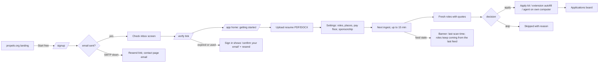
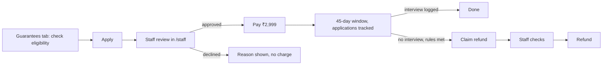
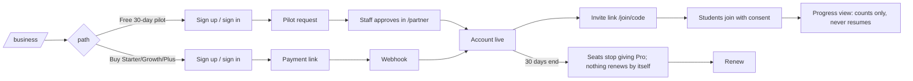

# 03 · User journeys

Each journey lists the happy path, where it can fail, and how the person recovers. "Verified" means the journey
was driven end to end in this audit on the local copy (evidence in `qa-tests.csv`).

## J1 · Job seeker: visitor to first application (Verified locally, except real email delivery)



Failure points worth watching after launch: email deliverability (verify link never arrives), a resume that parses
badly (PDF of images), and first matches arriving after the person has left. The getting-started card and the
welcome email cover the gap; there is no in-app chat or tour.

## J2 · Subscription (Implemented; checkout tested with signed test webhooks, live payments Not verified)

```mermaid
flowchart LR
  A[/pricing/ or Settings > Billing] --> B{signed in?}
  B -->|no| C[/signup?next=pricing/] --> A
  B -->|yes| D[Choose Pro or Ultra, INR or USD]
  D -->|INR| E[Razorpay subscription link]
  D -->|USD| F[Dodo checkout]
  E & F --> G[Webhook, signature checked] --> H[Plan active, limits raised]
  E & F -->|abandoned| I[Plan stays Free; can retry]
  G -->|webhook fails| J[Provider retries; admin can grant plan in /admin]
  H --> K[Cancel in Settings: runs to period end] --> L[Free]
```

## J3 · Interview Guarantee (Implemented, unit and API tests)



## J4 · Job Guarantee (Implemented, API tests; terms need legal review)

Request → staff partner reviews the profile → proposes roles → member approves each → applications → placed →
fee is 8% of first-year salary in instalments after joining (manual payment links) → staff records payments.
Failure: the member joins and doesn't pay (contract enforceability is a legal question, register R-040).

## J5 · Business: consultancy pilot or purchase (Verified locally with test webhooks)



## J6 · Student joins a consultancy (Verified locally)

`/join/{code}` → reads exactly what the consultancy will see → sign up (verify link returns to the join page) →
consent → seat with Pro. Failure: seats full (clear message), bad code (404 page), account already on a paid plan
(keeps own plan). Leave any time in Settings.

## J7 · Operator (Verified locally)

Admin signs in → two-step code (required for staff and admin in production) → `/admin`: overview, find an
account, grant a plan, make staff, reset two-step, suspend; `/staff`: guarantee cases; `/partner`: business
accounts and pilot approvals. Every change is written to the audit log.

## J8 · Account recovery (Implemented)

Forgot password → neutral message → reset link → new password → other devices signed out → "password changed"
email. Lost authenticator → a recovery code at the code step, or an admin resets two-step after checking identity.
