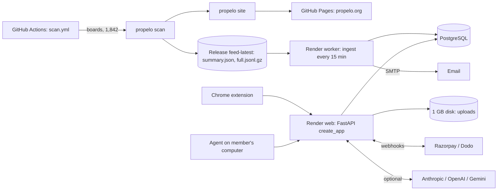

# 08 · Technical architecture audit

## Components
| component | tech | notes |
| --- | --- | --- |
| Web app | Python 3.11+, FastAPI, one process, Docker on Render | Pages are static HTML with a nonce; JSON API under `/api/` |
| Worker | same image, `propelo cloud worker` | Task table with retries: ingest, match_user, send_email, alerts, autosend, cleanup |
| Database | PostgreSQL 16 in production; SQLite for local and tests | 11 forward-only migrations; see [generated/database.md](generated/database.md) |
| Scanner | `propelo scan` on GitHub Actions | Thread pool per board; 60-minute deadline keeps late boards' previous roles |
| Site | `propelo site` static build | Landing, job board, docs, scam check, demo, robots, sitemap, RSS, JSON API |
| Extension | Manifest V3 | Autofills, never submits |
| Mobile | Capacitor shell around the web app | Not built in this audit |

## Strengths
- Small surface: one web process, one worker, one database; easy to reason about and cheap (fits the free/low
  Render tiers apart from the database).
- Feed publishing does not depend on the app being up; the site keeps working if Render is down.
- Tests run on both SQLite and PostgreSQL; migrations are tested from empty.
- Docs generated from code and checked in CI (this repository).

## Debt and scaling limits
| item | impact | when to act |
| --- | --- | --- |
| Uploads on one disk (R-025) | Cannot run two web instances | Before horizontal scaling |
| Scan cadence bound by Actions runners | 5-9 h between landed feeds | If freshness becomes a selling point, move the scan to a small always-on worker |
| `app.py` is large (single module with most routes) | Slower reviews | Split by area (auth, billing, partners, staff) when the next large feature lands |
| No product analytics (R-022) | Blind on activation | Before paid acquisition |
| Single region | Latency outside the host region | Fine for India/UK/US at current scale |

## Environments
Local (SQLite, dev mail), CI (SQLite + PostgreSQL service), production (Render). There is no staging
environment; use a Render preview environment or a second free service with test keys before risky releases.
